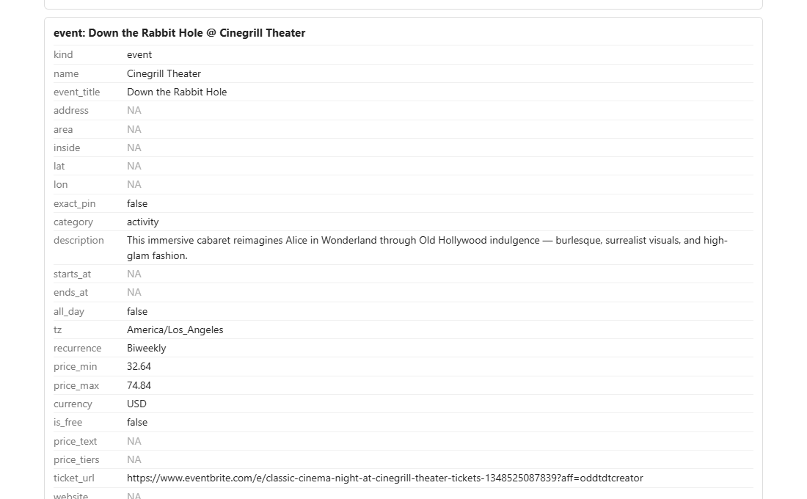
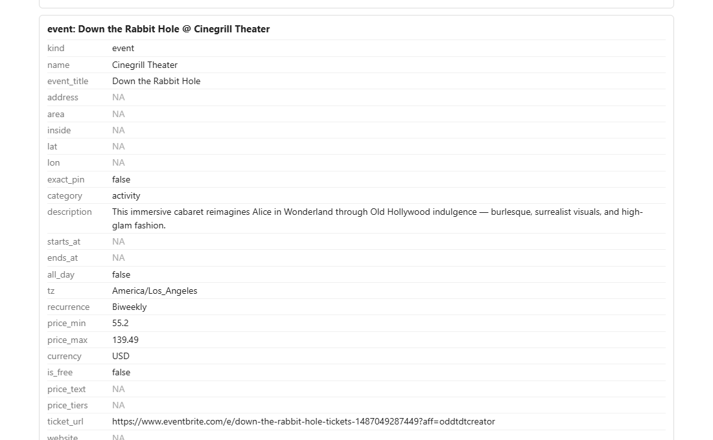

# 2026-10-17: Hollywood Roosevelt events

**Link tested:** https://www.thehollywoodroosevelt.com/events/los-angeles/down-the-rabbit-hole (from bookmarks). It is a calendar page listing four recurring shows at The Hollywood Roosevelt, not a single-event page.

## Before

What the app showed for "Down the Rabbit Hole":

- **Price $32.64 to $74.84.** That is the price of a different show, Classic Cinema Night. The real price on its own ticket page is $55.20 to $139.49.
- **Ticket link goes to Classic Cinema Night.** Tapping "tickets" would have opened the wrong show.
- The other two shows with ticket links had the same wrong price and the same wrong link, and Chess and Jazz was given a price although the page has no ticket link for it.

## What changed

When a page lists several events, each event now uses the ticket link that is actually about it, and gets that link's price. If the page has no ticket link for an event, the app leaves the price empty instead of borrowing another show's.

## After

- Down the Rabbit Hole now shows **$55.20 to $139.49** and its own ticket link.
- Classic Cinema Night and Magic at the Library Bar also got their own links. Chess and Jazz now has no price, which is correct since the page gives none.
- Still wrong in this view: no street address, no show time (the page says every other Saturday, 8 PM, 18+), and the venue name reads "Cinegrill Theater" rather than The Hollywood Roosevelt.

## Still not fixed

- **Address and venue:** the page footer says 7000 Hollywood Blvd, Los Angeles 90028, phone 323-785-7000, but none of it reaches the item. Suggestion: tell the extractor the page-wide address and hotel name apply to every event. The venue search service was down in this run, so it could not fill the gap either.
- **Show times:** "Every Other Saturday, 8 PM" is not turned into a time. Needs a decision on how recurring shows should be stored.
- **Titles and prices:** Chess and Jazz has no show title (only the room name), and Magic at the Library Bar came back with a price of $0, which I did not check against its ticket page.

## Technical notes

- Cause: with no ticket link of its own, each event fell back to the first ticket link on the listing page.
- Fix: `own_ticket_link` and `enrich` in `backend/app/ingest/pricing.py`; test added in `backend/tests/test_pricing.py`. Backend tests: 241 passed.
- Screenshots are cropped from the import-tester result page, which shows raw field names.
