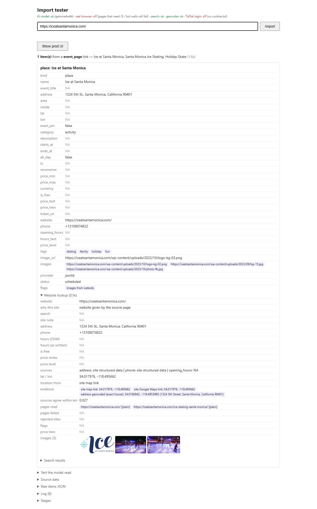

# 2026-10-18: Ice at Santa Monica (seasonal ice rink)

**Link tested:** https://iceatsantamonica.com/ (from bookmarks). The home page of a holiday ice rink that is closed between seasons.

## Before

What the app showed:

- Name, street address, phone number and a correct map pin were all right, and it found three photos.
- No price, no opening hours and no dates. This is correct today: the rink's site says "2026 season details coming soon" and that it returns in **November 2026**, with no prices or hours published yet. It rightly ignored last season's dates (Nov 7, 2025 to Jan 19, 2026) that are still on an old page.
- The place is marked "scheduled", but nothing tells you it is closed now or that it reopens in November 2026.
- The main photo is the rink's logo rather than a photo of the rink.

## What changed

Nothing was changed today. I found no small, clearly safe fix.

## After

No after screenshot, since nothing was fixed.

## Still not fixed

- The app does not capture "reopens November 2026" for a seasonal place that is closed. Suggestion: when a site says it returns in a given month, save that as an expected reopening date and show it on the card, so the place does not look open year-round. This touches how dates are stored, so it needs your call.
- The logo is picked as the main photo. Suggestion: prefer a real photo over an image whose name looks like a logo (small and probably safe, but worth checking against more venues first).

## Technical notes

Tested through the import tester. The pipeline read the home page JSON-LD plus the venue website lookup; both agree with the live site. The reopening text lives only in the home page body, which the fast path does not turn into a date. No code touched.
