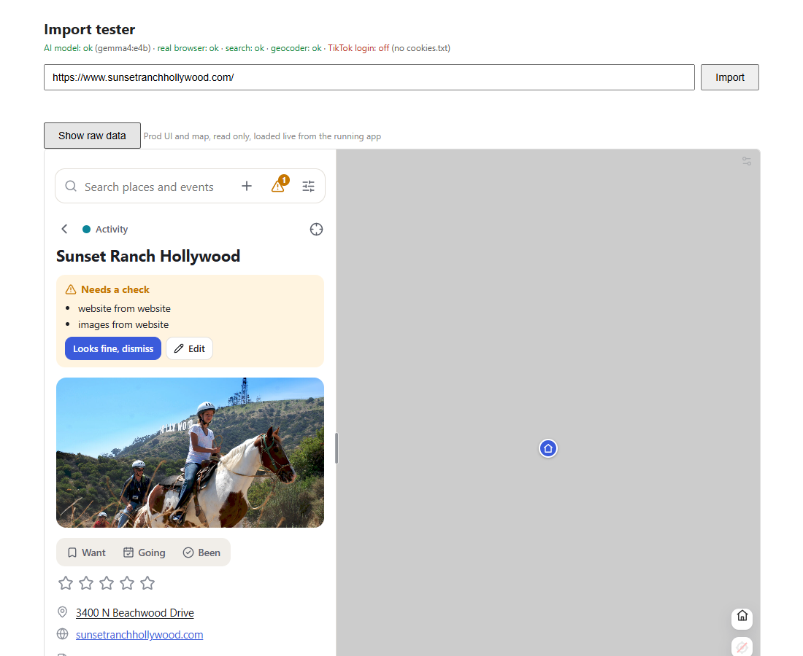
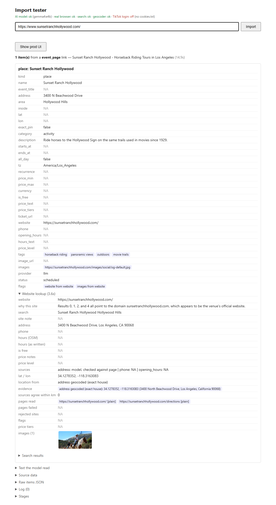
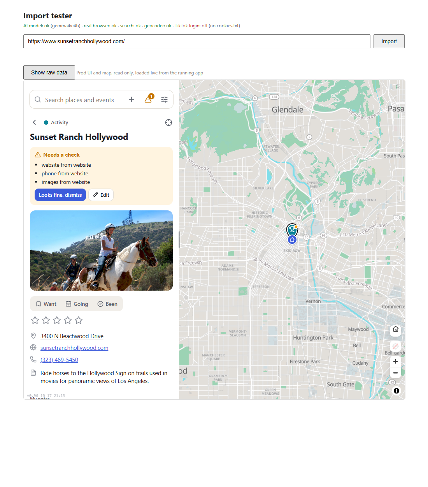
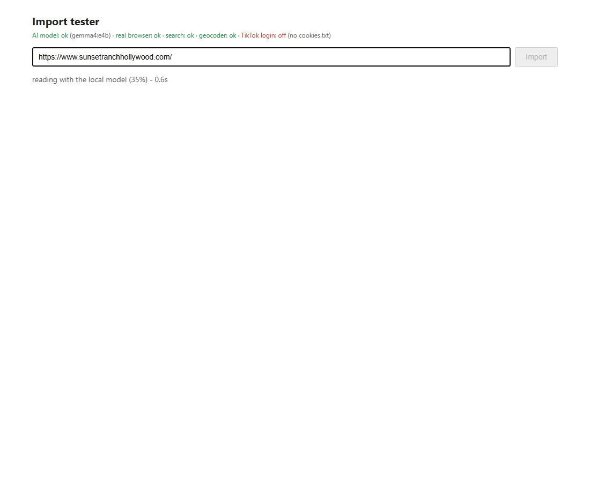

# 2026-10-19 (second run): Sunset Ranch Hollywood

**Link tested:** https://www.sunsetranchhollywood.com/ (from bookmarks). The home page of a family-run horseback riding ranch in the Hollywood Hills. Tested on the live import service (the same one the app uses; nothing was saved).

## What the live app showed BEFORE





I read the ranch site and other public pages about it by hand:

| Field | Real value | What the import produced | Result |
|---|---|---|---|
| Name | Sunset Ranch Hollywood | Sunset Ranch Hollywood | correct |
| Address | 3400 N Beachwood Drive, Los Angeles, CA 90068 | same, pinned to the right house | correct |
| Category | Activity (guided trail rides) | Activity | correct |
| Website | sunsetranchhollywood.com | same | correct |
| Photo | Rider with the Hollywood Sign behind | one photo | correct |
| Phone | (323) 469-5450 (printed on several public pages about the ranch, not on the ranch's own pages) | nothing | MISSED |
| Hours | Day rides roughly 9 AM to 3 PM, evening rides in the afternoon and evening (third-party pages disagree on details; the ranch site gives no hours) | nothing | MISSED (not on the ranch site) |
| Prices | Not shown on the ranch site or the pages I read (booking is separate) | nothing | nothing to find |
| Ticket / booking link | No booking link found on the pages read | nothing | nothing to find |

- The phone number was publicly available on other pages that turned up in the search, but the app only ever looked at the ranch's own site, which has no phone number.
- Hours exist only on third-party pages and they do not fully agree, so nothing could be filled safely.

## What changed

When the ranch's own site has no phone number, the app now also looks at a couple of other non-review pages about the ranch that show a phone number, and takes the number from there only if it really appears on the page.

## What it shows AFTER (fixed code, not yet live)





- The phone number (323) 469-5450 now shows up on the place card, and the card says the phone came from another page.
- Hours and prices are still empty.

## Still not fixed

- Opening hours: only third-party pages have them and they conflict. Suggestion: show them with a "from another site, please check" label rather than filling them silently (bigger decision).
- Tours are described on separate pages (day rides, evening rides, private rides) with durations (about 1 hour and 2 hours). The app does not read those pages or make a tour list. Suggestion: read "tours" pages as part of the website lookup.

<details><summary>Raw output (prod import, before the fix)</summary>

```json
[
 {
  "kind": "place",
  "name": "Sunset Ranch Hollywood",
  "event_title": null,
  "address": "3400 N Beachwood Drive",
  "area": "Hollywood Hills",
  "inside": null,
  "lat": null,
  "lon": null,
  "exact_pin": false,
  "category": "activity",
  "description": "Ride horses to the Hollywood Sign on the same trails used in movies since 1929.",
  "starts_at": null,
  "ends_at": null,
  "all_day": false,
  "tz": "America/Los_Angeles",
  "recurrence": null,
  "price_min": null,
  "price_max": null,
  "currency": null,
  "is_free": null,
  "price_text": null,
  "price_tiers": [],
  "ticket_url": null,
  "website": "https://sunsetranchhollywood.com/",
  "phone": null,
  "opening_hours": null,
  "hours_text": null,
  "price_level": null,
  "tags": [
   "horseback riding",
   "panoramic views",
   "outdoors",
   "movie trails"
  ],
  "image_url": null,
  "images": [
   "https://sunsetranchhollywood.com/images/social/og-default.jpg"
  ],
  "provider": "llm",
  "status": "scheduled",
  "flags": [
   "website from website",
   "images from website"
  ],
  "venue": {
   "name": "Sunset Ranch Hollywood",
   "flags": [],
   "pages": [
    {
     "url": "https://sunsetranchhollywood.com/",
     "via": "plain"
    },
    {
     "url": "https://sunsetranchhollywood.com/directions",
     "via": "plain"
    }
   ],
   "website": "https://sunsetranchhollywood.com/",
   "search_query": "Sunset Ranch Hollywood Hollywood Hills",
   "search_results": [
    {
     "title": "Sunset Ranch Hollywood - Horseback Riding Tours in Los Angeles",
     "url": "https://sunsetranchhollywood.com/",
     "aggregator": false
    },
    {
     "title": "Directions - Sunset Ranch Hollywood",
     "url": "https://sunsetranchhollywood.com/directions",
     "aggregator": false
    },
    {
     "title": "Sunset Ranch Hollywood - All You SHOULD Know Before Going (2026 Reviews)",
     "url": "https://www.tripadvisor.com/Attraction_Review-g32655-d156741-Reviews-Sunset_Ranch_Hollywood-Los_Angeles_California.html",
     "aggregator": true
    },
    {
     "title": "SUNSET RANCH HOLLYWOOD STABLES - Updated October 2026 - Yelp",
     "url": "https://www.yelp.com/biz/sunset-ranch-hollywood-stables-los-angeles",
     "aggregator": true
    },
    {
     "title": "Sunset Ranch Hollywood: 404 - Trail Not Found",
     "url": "https://sunsetranchhollywood.com/home.html",
     "aggregator": false
    },
    {
     "title": "Saddle Up at Sunset Ranch: Griffith Park Trail Rides with Hollywood ...",
     "url": "https://www.daytrippen.com/sunset-ranch-griffith-park-trail-rides/",
     "aggregator": false
    },
    {
     "title": "Horseback Riding at Sunset Hollywood Ranch",
     "url": "https://www.hollywoodsign.org/blog/horseback-riding-at-sunset-hollywood-ranch",
     "aggregator": false
    },
    {
     "title": "Day Tours - Sunset Ranch Hollywood",
     "url": "https://sunsetranchhollywood.com/day-tours",
     "aggregator": false
    },
    {
     "title": "Things to Do in LA | Sunset Ranch Hollywood",
     "url": "https://sunsetranchhollywood.com/things-to-do",
     "aggregator": false
    },
    {
     "title": "Sunset Ranch Hollywood | Horseback Riding in Los Angeles",
     "url": "https://localhorsebackriding.com/listing/sunset-ranch-hollywood/",
     "aggregator": false
    },
    {
     "title": "Los Angeles' oldest ranch offers one of the city's most iconic ...",
     "url": "https://secretlosangeles.com/la-sunset-ranch-hollywood-horseback-hollywood-sign/",
     "aggregator": true
    },
    {
     "title": "Sunset Ranch Hollywood in Central LA, California | Family Action",
     "url": "https://www.familyaction.com/activity/sunset-ranch-hollywood-los-angeles",
     "aggregator": false
    }
   ],
   "site_pick_why": "Results 0, 1, 2, 5, and 6 all point to the domain sunsetranchhollywood.com, which appears to be the official website for Sunset Ranch Hollywood.",
   "ticket_links": [],
   "facts_input_chars": 1388,
   "address": "3400 N Beachwood Drive, Los Angeles, CA 90068",
   "phone": null,
   "opening_hours": null,
   "hours_text": null,
   "price_tiers": [],
   "is_free": null,
   "price_text": null,
   "price_level": null,
   "sources": {
    "address": "model, checked against page",
    "phone": null,
    "opening_hours": null
   },
   "images": [
    "https://sunsetranchhollywood.com/images/social/og-default.jpg"
   ],
   "location": {
    "lat": 34.1278352,
    "lon": -118.3163083,
    "method": "address geocoded (exact house)",
    "evidence": [
     {
      "method": "address geocoded (exact house)",
      "lat": 34.1278352,
      "lon": -118.3163083,
      "matched": "3400 North Beachwood Drive, Los Angeles, California 90068"
     }
    ],
    "agreement_km": 0.0
   },
   "elapsed": 4.2
  }
 }
]
```
</details>

## Technical notes

- Touched backend/app/ingest/venue.py (new other_pages, used in lookup when neither the site nor its structured data gave a phone) and backend/tests/test_venue.py.
- Cause: the venue lookup read only the official site (home + directions). The other search results were listed but never read. A first version also failed because the page text sent to the model is cut at 4500 characters and the number sat at about char 4800, so the extra pages are now reduced to the snippets around each phone number.
- The phone is still checked against the page text (digits must appear) and the page must mention the venue name.
- Desktop run and prod tester agreed on the before result.
