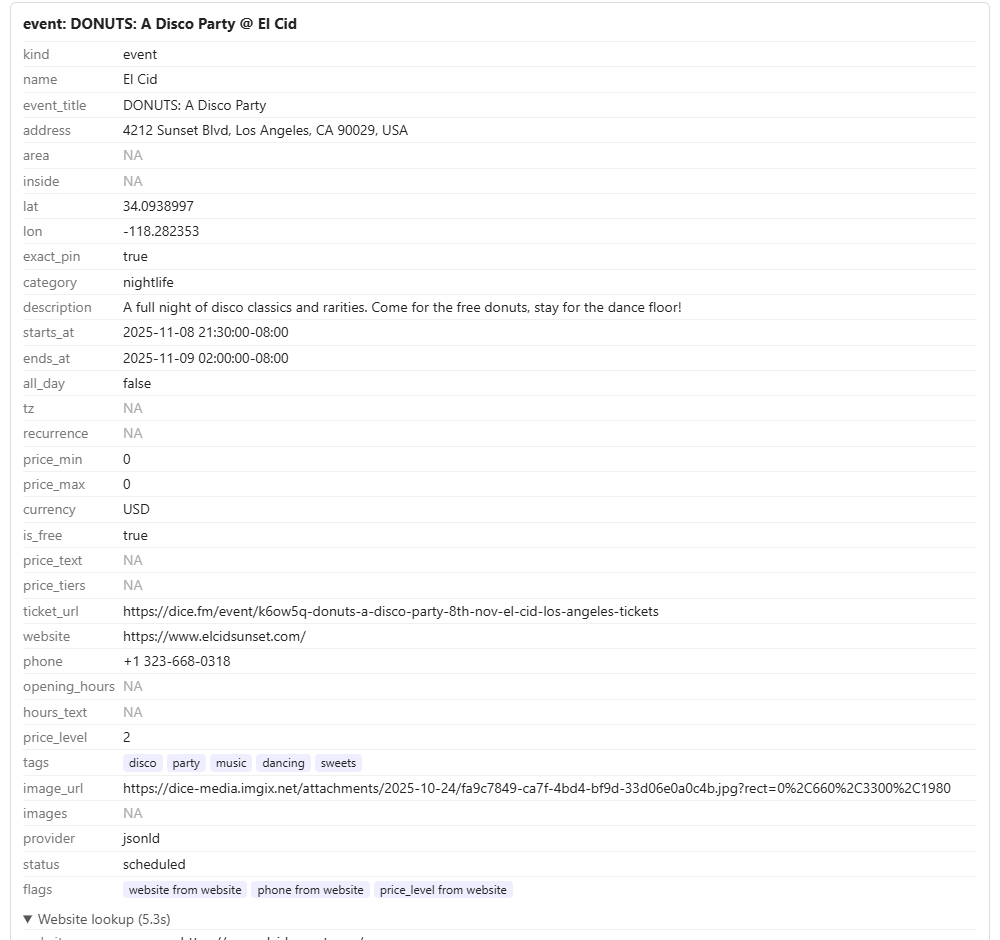

# 2026-10-19: DONUTS: A Disco Party at El Cid (ticket page)

**Link tested:** https://dice.fm/event/k6ow5q-donuts-a-disco-party-8th-nov-el-cid-los-angeles-tickets (from bookmarks). A Dice ticket page for a single one-night party at the El Cid club in Silver Lake.

## Before

What the app showed, compared with the real page:

- Right: event name, club name, street address and map pin, date and time (Sat Nov 8, 9:30 pm to 2:00 am), description, photo, ticket link, club website and phone. "Free" matches the page ("From free").
- Wrong: the party is marked as coming up ("scheduled"), but it happened on **Nov 8, 2025**, almost a year ago. Nothing tells you the link is for a past event.
- Missing: the page says "This is a 21+ event". The app has nowhere to show an age limit, so it was dropped.
- Minor: one of the tags is "sweets" (from the free-donuts line), which says little about the party.

## What changed

Nothing was changed today. I found no small, clearly safe fix.

## After

No after image, since nothing was fixed.

## Still not fixed

- Past events look like upcoming ones when you import them. Suggestion: when the end time is already in the past, warn at import time ("this event already happened") or save it as archived.
- No age limit (21+, 18+, all ages) on events. Suggestion: add an optional age-limit note to events and fill it from ticket pages; it needs a small database change, so it is a decision for you.

## Technical notes

- Event data came from the page's structured event data (provider `jsonld`) in `backend/app/ingest/event_page.py`; `event_item` always sets `status="scheduled"` unless the page says cancelled, and has no age field in `ItemHint` (`items.py`).
- The $0 price is genuine here ("From free"), so the free flag was correct.
