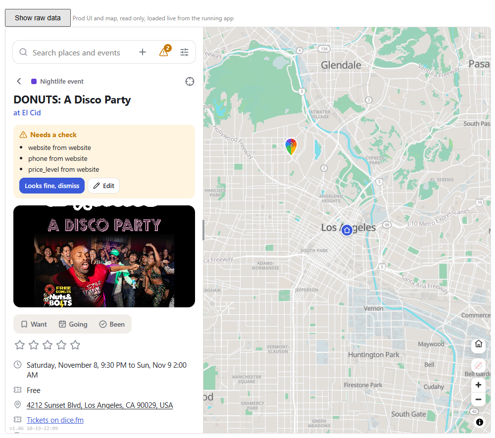
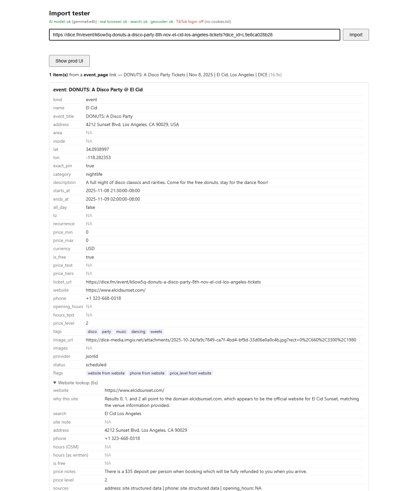
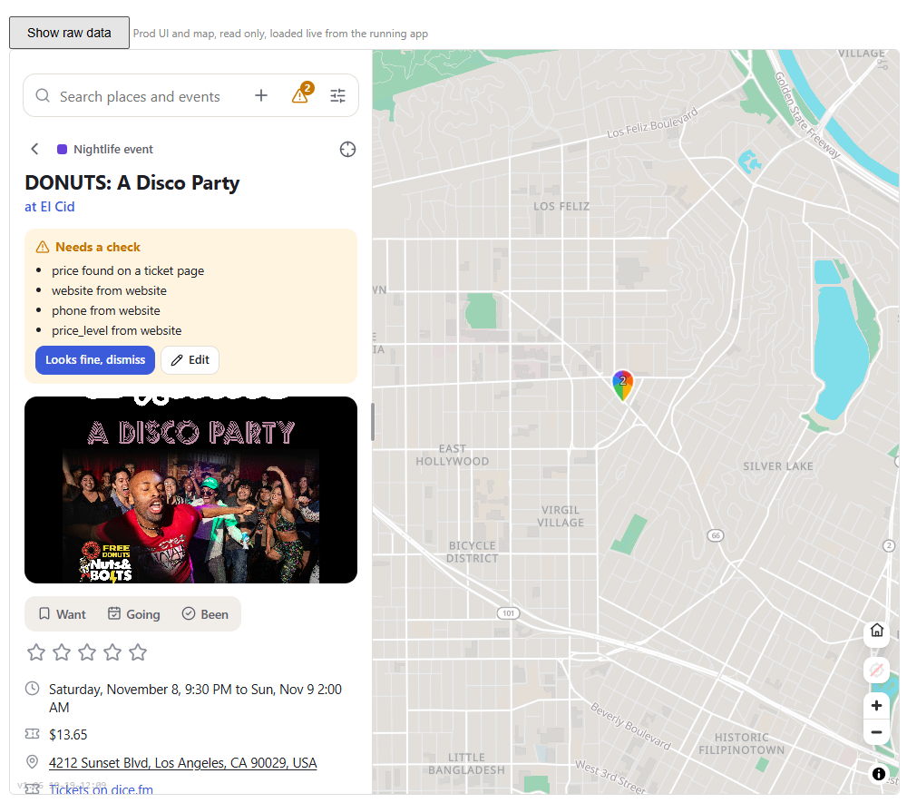
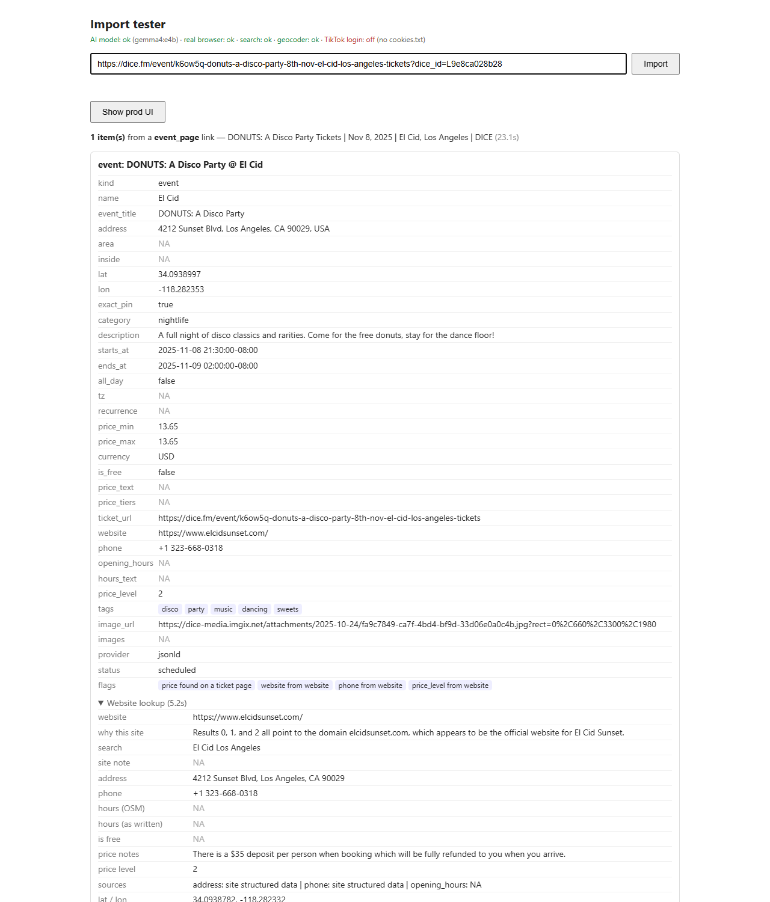

# 2026-10-23: DONUTS: A Disco Party at El Cid (Dice)

**Link tested:** https://dice.fm/event/k6ow5q-donuts-a-disco-party-8th-nov-el-cid-los-angeles-tickets (from bookmarks). A single-event ticket page on Dice for a disco night at El Cid in Silver Lake. Tested on the live import service (nothing was saved).

## What the live app showed BEFORE





I opened the Dice page by hand. Raw output for the live run is at the bottom (the desktop copy gave the same answer).

| Field | Real value | What the import produced | Verdict |
|---|---|---|---|
| Event name | DONUTS: A Disco Party | same | correct |
| Venue | El Cid | same | correct |
| Address | 4212 Sunset Blvd, Los Angeles, CA 90029 | same | correct |
| Date / start | Sat Nov 8, 2025, 9:30 PM (doors 9:30 PM) | same | correct |
| End | 2:00 AM (listed in the page data) | Nov 9, 2:00 AM | correct |
| Price | $13.65 general admission (page says "Off Sale") | **Free** | wrong |
| Ticket link | the Dice page | same | correct |
| Age limit | 21+ | not shown | MISSED |
| Phone / website | +1 323-668-0318, elcidsunset.com | same | correct |
| Photo | the party flyer | same | correct |
| Already happened? | Yes, this was Nov 2025 | shown as a normal upcoming event | wrong |

- The app called the night **free**. The only "free" on the page is the free donuts.
- Dice puts $0.00 in the page data once an event is off sale, and the app took that as "free entry".
- The party took place almost a year ago, but the app still lists it as scheduled.
- The 21+ rule was not picked up.

## What changed

The app no longer treats a $0.00 ticket range from a ticket site (or a sold-out ticket) as "free entry", and it no longer reads "free donuts" or "free parking" as a free event. When the price is really not on the page, it now looks it up on the ticket page instead.

## What it shows AFTER (fixed code, not yet live)





- The price now reads **$13.65** instead of Free.
- The name, address, time and ticket link are still right.

## Still not fixed

- **Past events look current.** An event whose date is long gone is saved as scheduled. Suggestion: mark events that ended in the past as archived on import (or warn "this already happened"), which needs a decision on how past events should appear.
- **21+ is not captured.** There is no age-limit field. Suggestion: add one to the event details (a schema change, so flagged only).
- The price shown ($13.65) is the original ticket price; the page itself says the event is off sale.

<details><summary>Raw output (live import service)</summary>

```json
{
 "id": "ea3ba802",
 "url": "https://dice.fm/event/k6ow5q-donuts-a-disco-party-8th-nov-el-cid-los-angeles-tickets?dice_id=L9e8ca028b28",
 "status": "done",
 "stage": "done",
 "pct": 100,
 "stages": [
  {
   "t": 0.0,
   "stage": "reading the link",
   "pct": 10
  },
  {
   "t": 0.2,
   "stage": "reading with the local model",
   "pct": 35
  },
  {
   "t": 9.0,
   "stage": "finding the website of El Cid",
   "pct": 55
  },
  {
   "t": 12.4,
   "stage": "reading www.elcidsunset.com",
   "pct": 55
  },
  {
   "t": 13.9,
   "stage": "reading hours, prices and contact details",
   "pct": 55
  },
  {
   "t": 15.7,
   "stage": "collecting photos and map location",
   "pct": 55
  },
  {
   "t": 15.8,
   "stage": "done",
   "pct": 100
  }
 ],
 "logs": [],
 "result": {
  "kind": "event_page",
  "title": "DONUTS: A Disco Party Tickets | Nov 8, 2025 | El Cid, Los Angeles | DICE",
  "posted": null,
  "items": [
   {
    "kind": "event",
    "name": "El Cid",
    "event_title": "DONUTS: A Disco Party",
    "address": "4212 Sunset Blvd, Los Angeles, CA 90029, USA",
    "area": null,
    "inside": null,
    "lat": 34.0938997,
    "lon": -118.282353,
    "exact_pin": true,
    "category": "nightlife",
    "description": "A full night of disco classics and rarities. Come for the free donuts, stay for the dance floor!",
    "starts_at": "2025-11-08 21:30:00-08:00",
    "ends_at": "2025-11-09 02:00:00-08:00",
    "all_day": false,
    "tz": null,
    "recurrence": null,
    "price_min": 0.0,
    "price_max": 0.0,
    "currency": "USD",
    "is_free": true,
    "price_text": null,
    "price_tiers": [],
    "ticket_url": "https://dice.fm/event/k6ow5q-donuts-a-disco-party-8th-nov-el-cid-los-angeles-tickets",
    "website": "https://www.elcidsunset.com/",
    "phone": "+1 323-668-0318",
    "opening_hours": null,
    "hours_text": null,
    "price_level": 2,
    "tags": [
     "disco",
     "party",
     "music",
     "dancing",
     "sweets"
    ],
    "image_url": "https://dice-media.imgix.net/attachments/2025-10-24/fa9c7849-ca7f-4bd4-bf9d-33d06e0a0c4b.jpg?rect=0%2C660%2C3300%2C1980",
    "images": [],
    "provider": "jsonld",
    "status": "scheduled",
    "flags": [
     "website from website",
     "phone from website",
     "price_level from website"
    ],
    "venue": {
     "name": "El Cid",
     "flags": [
      "address dropped, no street number: Silver Lake in Los Angeles"
     ],
     "pages": [
      {
       "url": "https://www.elcidsunset.com/",
       "via": "plain"
      },
      {
       "url": "https://www.elcidsunset.com/book",
       "via": "plain"
      },
      {
       "url": "https://www.elcidsunset.com/contact",
       "via": "plain"
      },
      {
       "url": "https://www.exploretock.com/elcid",
       "via": "plain"
      }
     ],
     "website": "https://www.elcidsunset.com/",
     "search_query": "El Cid Los Angeles",
     "search_results": [
      {
       "title": "El Cid Sunset - L.A.'s premiere Flamenco club & live event destination",
       "url": "https://www.elcidsunset.com/",
       "aggregator": false
      },
      {
       "title": "Upcoming Events - Check out our latest parties & concerts - El Cid",
       "url": "https://www.elcidsunset.com/events",
       "aggregator": false
      },
      {
       "title": "EL CID RESTAURANT - Updated October 2026 - 819 Reviews - Yelp",
       "url": "https://www.yelp.com/biz/el-cid-restaurant-los-angeles",
       "aggregator": true
      },
      {
       "title": "El Cid on Sunset | Los Angeles CA - Facebook",
       "url": "https://www.facebook.com/elcidsunset/",
       "aggregator": true
      },
      {
       "title": "Restaurant - Experience classic Spanish cuisine — El Cid Sunset",
       "url": "https://www.elcidsunset.com/restaurant",
       "aggregator": false
      },
      {
       "title": "El Cid in Los Angeles - Mato Events",
       "url": "https://ma.to/venue/elcidsunset",
       "aggregator": false
      },
      {
       "title": "Los Angeles, United States of America - El Cid tickets and events",
       "url": "https://dice.fm/venue/el-cid-ven7",
       "aggregator": false
      },
      {
       "title": "El Cid - Updated 2026, Spanish Restaurant in Los Angeles, CA",
       "url": "https://www.opentable.com/r/el-cid-los-angeles",
       "aggregator": true
      },
      {
       "title": "El Cid Los Angeles - Upcoming Events & Showtimes - Mood",
       "url": "https://events.musicofourdesire.com/venue/el-cid",
       "aggregator": false
      },
      {
       "title": "El Cid on Sunset, 4212 W Sunset Boulevard, Los Angeles, CA (2026)",
       "url": "https://www.findglocal.com/US/Los-Angeles/659388424241395/El-Cid-on-Sunset",
       "aggregator": false
      },
      {
       "title": "El Cid - Los Angeles Events & Tickets",
       "url": "https://los-angeles.events/venue/el-cid-los-angeles/",
       "aggregator": false
      },
      {
       "title": "El Cid (@elcidsunset) • Instagram photos and videos",
       "url": "https://www.instagram.com/elcidsunset/",
       "aggregator": true
      }
     ],
     "site_pick_why": "Results 0, 1, and 2 all point to the domain elcidsunset.com, which appears to be the official website for El Cid Sunset, matching the venue name and location context.",
     "ticket_links": [
      "https://www.exploretock.com/elcid"
     ],
     "facts_input_chars": 1954,
     "address": "4212 Sunset Blvd, Los Angeles, CA 90029",
     "phone": "+1 323-668-0318",
     "opening_hours": null,
     "hours_text": null,
     "price_tiers": [
      {
       "label": "Flamenco dinners",
       "price": 85,
       "note": "includes a four-course meal"
      },
      {
       "label": "Reservation Saturday Night Flamenco Dinner",
       "price": 25,
       "note": "deposit per person"
      }
     ],
     "is_free": null,
     "price_text": "There is a $35 deposit per person when booking which will be fully refunded to you when you arrive.",
     "price_level": 2,
     "sources": {
      "address": "site structured data",
      "phone": "site structured data",
      "opening_hours": null
     },
     "images": [
      "http://static1.squarespace.com/static/644628eca8a39f309e4134bf/t/661376e8ea5c6d0117a5d866/1790977268930/El+Cid+SEO+Image+-+Home.png?format=1500w",
      "https://images.squarespace-cdn.com/content/v1/644628eca8a39f309e4134bf/29bc1904-ee60-4c8f-b43b-3edbb265f599/A54A3697.jpg",
      "https://images.squarespace-cdn.com/content/v1/644628eca8a39f309e4134bf/f1f00a38-7bbd-4408-84f0-4ab4c2f29731/A54A0575.jpg",
      "https://images.squarespace-cdn.com/content/v1/644628eca8a39f309e4134bf/b902b495-7ae3-40d5-8094-bd0ec4c55bb6/A54A7276.jpg",
      "https://images.squarespace-cdn.com/content/v1/644628eca8a39f309e4134bf/00a05a22-dedc-4d21-9958-e16c7e40904d/A54A0481.jpg",
      "https://images.squarespace-cdn.com/content/v1/644628eca8a39f309e4134bf/bcfb6b32-6c4d-42d6-923b-42c5c323c8d1/IMG_2863.jpeg",
      "https://images.squarespace-cdn.com/content/v1/644628eca8a39f309e4134bf/e2cff223-ff96-4ac4-9edc-07b1b254d3b6/_DSC4307.jpg",
      "https://images.squarespace-cdn.com/content/v1/644628eca8a39f309e4134bf/9c7725ef-809e-4d15-a31c-6ad6e34c9e2d/_DSC4397.jpg",
      "https://images.squarespace-cdn.com/content/v1/644628eca8a39f309e4134bf/988bf261-c691-4951-bfc9-84b896ac3d8d/DSC_0008.jpg",
      "https://images.squarespace-cdn.com/content/v1/644628eca8a39f309e4134bf/e5e1e9aa-cd92-4999-a298-e7068d7056ed/IMG_3627.JPG",
      "http://static1.squarespace.com/static/644628eca8a39f309e4134bf/t/66357b8be3e22e2adc6416be/1790977268930/El+Cid+SEO+Image+-+Book+An+Event.png?format=1500w",
      "https://images.squarespace-cdn.com/content/v1/644628eca8a39f309e4134bf/b0ac7633-6e3f-4fce-b022-7cf780b870d7/_MG_2606.jpg"
     ],
     "location": {
      "lat": 34.0938782,
      "lon": -118.282332,
      "method": "address geocoded (exact house)",
      "evidence": [
       {
        "method": "address geocoded (exact house)",
        "lat": 34.0938782,
        "lon": -118.282332,
        "matched": "4212 West Sunset Boulevard, Los Angeles, California 90029"
       }
      ],
      "agreement_km": 0.0
     },
     "elapsed": 6.8
    }
   }
  ],
  "source": {
   "caption": null,
   "transcript": null,
   "raw": {
    "page": {
     "url": "https://dice.fm/event/k6ow5q-donuts-a-disco-party-8th-nov-el-cid-los-angeles-tickets?dice_id=L9e8ca028b28",
     "title": "DONUTS: A Disco Party Tickets | Nov 8, 2025 | El Cid, Los Angeles | DICE",
     "description": "A full night of disco classics and rarities. Come for the free donuts, stay for the dance floor!",
     "image": "https://dice-media.imgix.net/attachments/2025-10-24/fa9c7849-ca7f-4bd4-bf9d-33d06e0a0c4b.jpg?rect=0%2C660%2C3300%2C1980&w=1300&h=630&auto=compress",
     "jsonld_items": 1
    }
   }
  },
  "extracted_text": null,
  "note": null,
  "preview_sel": "event:fe39aee0-1392-5d82-b0e7-b4a9aa5fc35b"
 },
 "error": null,
 "elapsed": 15.8
}
```

</details>

## Technical notes

- Cause 1 (`backend/app/ingest/event_page.py::_offers`): Dice's server-rendered JSON-LD has `AggregateOffer lowPrice/highPrice "0.00"` with no availability; `_offers` turned all-zero prices into `is_free=True`. Now a zero from low/highPrice with no availability, or any zero on an OutOfStock/SoldOut offer, is ignored (Eventbrite and Luma free events carry InStock and still work).
- Cause 2 (`backend/app/ingest/pricing.py::read_price`): the "must appear in page text" check accepted any "free" ("free donuts"), and the model returned price 0 with text "free". Added `FREE_ENTRY` wording check; a $0 price without such wording is dropped.
- Tests: `test_zero_price_range_without_availability_is_not_free`, `test_free_donuts_is_not_free_entry`, `test_zero_price_from_free_donuts_is_dropped`. Full backend suite: 250 passed.
