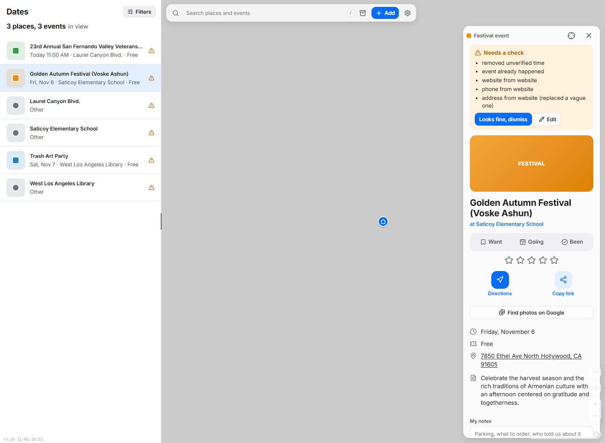
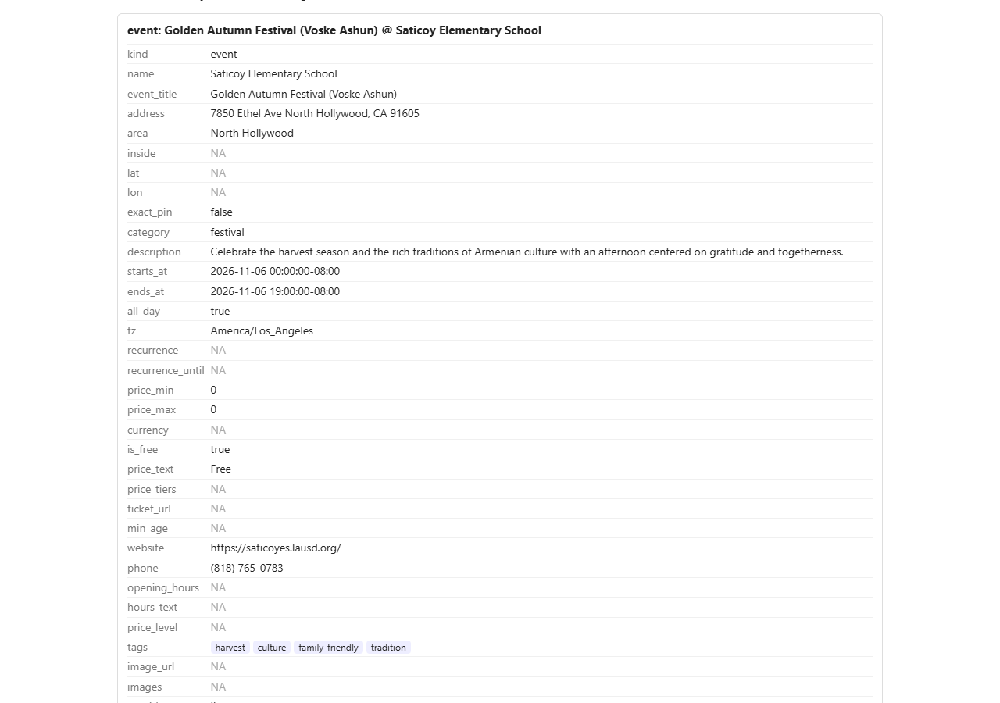
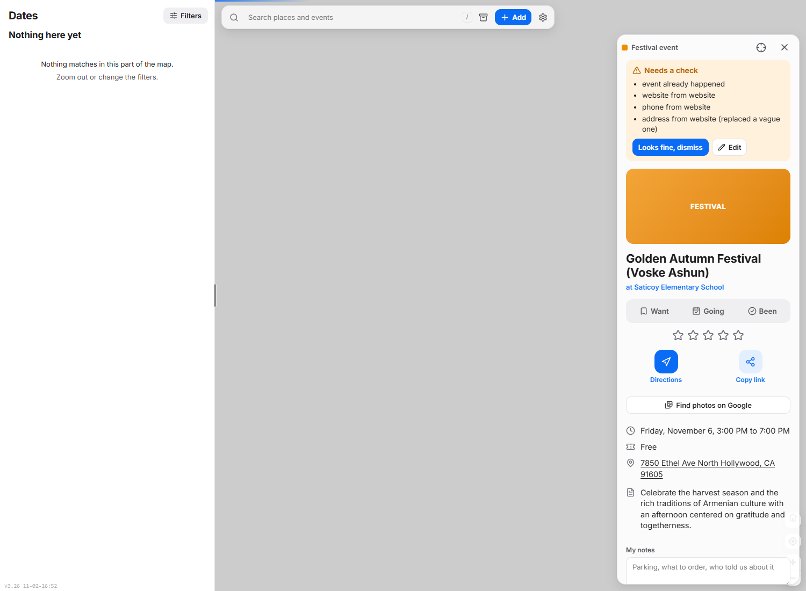
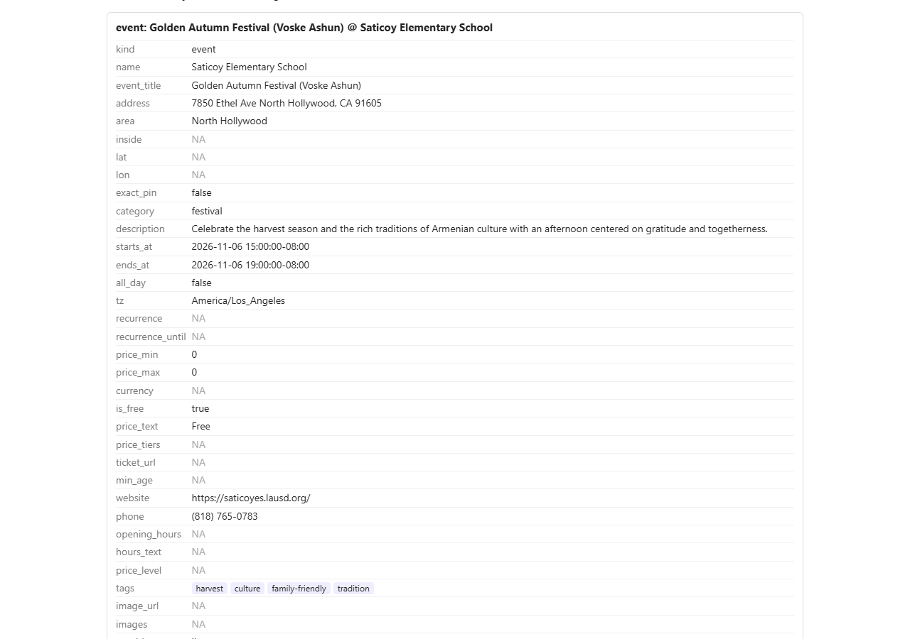

# 2026-11-11: a city video listing three free events

## 1. Link tested
https://www.youtube.com/watch?v=_NFglU-VI3g: the City of Los Angeles YouTube video "Things To Do (for the weekend of November 6th)". Its description lists three free events, each with a date, time, place and a "more info" link. This is the link that could not be tested on 2026-11-08 because the home server was stuck (`IM-33`). The server is back, so today's check ran on the live system.

## 2. What the live app showed before





The screenshots come from the desktop tester running the same code as the live app. The live result (saved in `raw/2026-11-11.json`) is the same except for the library's website, noted in the table.

| Field | Real value | What the live import produced | Result |
|---|---|---|---|
| **Golden Autumn Festival (Voske Ashun)** | | | |
| Title and venue | Golden Autumn Festival at Saticoy Elementary School, North Hollywood | same | correct |
| Date and time | Fri Nov 6, 2026, 3 to 7 PM | Fri Nov 6, all day, ending 7 PM | **wrong: start time dropped** |
| Address | not in the video (the school is at 7850 Ethel Ave, North Hollywood 91605) | 7850 Ethel Ave North Hollywood, CA 91605, found on the school's site | correct |
| Price | Free (RSVP requested) | Free | correct, RSVP note missed |
| More info link | cd2.lacity.gov/calendar | none (the school's own site is shown instead) | missed |
| Already over | yes | flagged "event already happened" | correct |
| **Trash Art Party** | | | |
| Title and venue | Trash Art Party at West Los Angeles Library | same | correct |
| Date and time | Sat Nov 7, 2026, 2 to 4 PM | Sat Nov 7, all day, ending 4 PM | **wrong: start time dropped** |
| Address | 11360 Santa Monica Blvd., Los Angeles, CA 90025 | same, pinned at the exact building | correct |
| Price | Free | Free | correct |
| More info link | lapl.org/events | none; website set to a library-software directory (librarytechnology.org) | missed, wrong website |
| Phone | 310-575-8323 (the branch) | 310-575-8323 | correct |
| **23rd Annual San Fernando Valley Veterans Day Parade** | | | |
| Title | as written | same | correct |
| Date and time | Wed Nov 11, 2026, 11 AM to 1 PM (parade starts 11:11) | Nov 11, 11 AM to 1 PM | correct |
| Place | Laurel Canyon Blvd. between San Fernando Mission Blvd. and Paxton St. | venue named "Laurel Canyon Blvd.", **no pin on the map** | missed |
| Category | parade / community event | "park" | wrong |
| Price | Free | Free | correct |
| More info link | cd7.lacity.gov/events | none | missed |
| Already over | yes (the test ran at 1:15 PM, 15 minutes after it ended) | flagged "event already happened" | correct |

What looked wrong:
- Two of the three events lost their start time. "3–7 PM" became "all day, until 7 PM", with a warning "removed unverified time".
- None of the three "more info" links was kept, and the library got the website of an unrelated directory.
- The parade has no pin, because its place is a stretch of street and not a building. It is also filed under "park".
- The video's captions could not be downloaded (the same on 2026-11-08). It did not matter here because the description had everything.

## 3. What changed
When a time range names AM or PM only once, like "3–7 PM", "2-4 PM" or "6 to 9:30 p.m.", the start time is now accepted as really being in the text. Before, the safety check that removes invented times only recognised "7 PM" in that range and threw the "3" away.

## 4. What it shows after (fixed code, not yet live)





- Golden Autumn Festival now shows "Friday, November 6, 3:00 PM to 7:00 PM", and the "removed unverified time" warning is gone.
- Trash Art Party now runs 2:00 PM to 4:00 PM.
- Everything else is unchanged: no info links, no pin for the parade. In the after run the library got no website at all (the search picks a different result each time). The list on the left of the after screenshot had not loaded yet when the picture was taken; the card on the right is the item.

## 5. Still not fixed
- **The live app is still on v3.26.** The deploy of November 7 (the list sort switch, v3.36) was cut off while the server was stuck, and never finished. It needs you to re-run the deploy from the GitHub Actions tab (`LC-13`). I do not deploy.
- The "more info" link written next to an event is not kept, and the venue's website can end up being a third-party directory. Suggestion: keep the link from the text as the event's link, and prefer search results on the same site (`IM-34`).
- An event on a stretch of street gets no pin and an odd category. Suggestion: pin the middle of the two cross streets and mark it approximate (`IM-35`). This is bigger work.
- The server cannot download YouTube captions ("too many requests", twice now). Suggestion: check again once the weekly downloader update is live, then add a retry or fall back to listening to the audio (`IM-36`).
- Small: "RSVP requested" and "parade begins at 11:11 AM" are not carried into the description.

## Roadmap changes
- `IM-33` done (this check). Added `IM-34` (info links), `IM-35` (street-stretch events), `IM-36` (captions blocked).
- `LC-11` closed: the Zephyrus was rebooted on 2026-11-10 and everything answers again. `LC-12` (watchdog) is no longer blocked.
- New `LC-13`, marked broken and needing you: the November 7 deploy never finished.
- `status.md`: date, live version, the new fix, the new gaps, "Waiting on Zaher".
- Roadmap and status start from the open PR #34 so the marks of the earlier open PRs carry over.

## Raw output

<details><summary>Prod tester response (search result lists left out; the full response is in raw/2026-11-11.json)</summary>

```json
{
 "status": "done",
 "elapsed": 65.3,
 "logs": [
  "21:15:43 INFO app.ingest.media: no subtitles: yt-dlp failed: ERROR: Unable to download video subtitles for 'en': HTTP Error 429: Too Many Requests"
 ],
 "items": [
  {
   "kind": "event",
   "name": "Saticoy Elementary School",
   "event_title": "Golden Autumn Festival (Voske Ashun)",
   "address": "7850 Ethel Ave North Hollywood, CA 91605",
   "area": "North Hollywood",
   "inside": null,
   "lat": null,
   "lon": null,
   "exact_pin": false,
   "category": "festival",
   "description": "Celebrate the harvest season and the rich traditions of Armenian culture with an afternoon centered on gratitude and togetherness.",
   "starts_at": "2026-11-06 00:00:00-08:00",
   "ends_at": "2026-11-06 19:00:00-08:00",
   "all_day": true,
   "tz": "America/Los_Angeles",
   "recurrence": null,
   "recurrence_until": null,
   "price_min": 0.0,
   "price_max": 0.0,
   "currency": null,
   "is_free": true,
   "price_text": "Free",
   "price_tiers": [],
   "ticket_url": null,
   "min_age": null,
   "website": "https://saticoyes.lausd.org/",
   "phone": "(818) 765-0783",
   "opening_hours": null,
   "hours_text": null,
   "price_level": null,
   "tags": [
    "harvest",
    "culture",
    "family-friendly",
    "tradition"
   ],
   "image_url": null,
   "images": [],
   "provider": "llm",
   "status": "scheduled",
   "flags": [
    "removed unverified time",
    "event already happened",
    "website from website",
    "phone from website",
    "address from website (replaced a vague one)"
   ],
   "venue": {
    "name": "Saticoy Elementary School",
    "flags": [],
    "pages": [
     {
      "url": "https://saticoyes.lausd.org/",
      "via": "plain"
     },
     {
      "url": "https://saticoyes.lausd.org/apps/pages/index.jsp?uREC_ID=3812780&type=d&pREC_ID=2706203",
      "via": "plain"
     },
     {
      "url": "https://saticoyes.lausd.org/apps/contact/",
      "via": "plain"
     }
    ],
    "website": "https://saticoyes.lausd.org/",
    "search_query": "Saticoy Elementary School North Hollywood",
    "site_pick_why": "Result 0 is the main website for Saticoy Elementary School (saticoyes.lausd.org), which is the official site for the venue.",
    "ticket_links": [],
    "facts_input_chars": 3989,
    "address": "7850 Ethel Ave North Hollywood, CA 91605",
    "phone": "(818) 765-0783",
    "opening_hours": null,
    "hours_text": null,
    "price_tiers": [
     {
      "label": "LA's Best Before School Program",
      "price": 0,
      "note": "Free to all Saticoy families"
     }
    ],
    "is_free": true,
    "price_text": null,
    "price_level": null,
    "sources": {
     "address": "model, checked against page",
     "phone": "model, checked against page",
     "opening_hours": null
    },
    "images": [
     "https://saticoyes.lausd.org/pics/LOSAUSD-SAE_LOGO.gif"
    ],
    "location": {
     "lat": 34.212735,
     "lon": -118.416712,
     "method": "address geocoded (exact house)",
     "evidence": [
      {
       "method": "address geocoded (exact house)",
       "lat": 34.212735,
       "lon": -118.416712,
       "matched": "7850 Ethel Avenue, Los Angeles, California 91605"
      }
     ],
     "agreement_km": 0.0
    },
    "elapsed": 31.6
   }
  },
  {
   "kind": "event",
   "name": "West Los Angeles Library",
   "event_title": "Trash Art Party",
   "address": "11360 Santa Monica Blvd., Los Angeles, CA 90025",
   "area": "Los Angeles",
   "inside": null,
   "lat": null,
   "lon": null,
   "exact_pin": false,
   "category": "arts",
   "description": "Transform everyday household waste into artful treasure at this creative, hands-on collage workshop.",
   "starts_at": "2026-11-07 00:00:00-08:00",
   "ends_at": "2026-11-07 16:00:00-08:00",
   "all_day": true,
   "tz": "America/Los_Angeles",
   "recurrence": null,
   "recurrence_until": null,
   "price_min": 0.0,
   "price_max": 0.0,
   "currency": null,
   "is_free": true,
   "price_text": "Free",
   "price_tiers": [],
   "ticket_url": null,
   "min_age": null,
   "website": "https://librarytechnology.org/library/15152",
   "phone": "310-575-8323",
   "opening_hours": null,
   "hours_text": null,
   "price_level": null,
   "tags": [
    "workshop",
    "creative",
    "art",
    "upcycled"
   ],
   "image_url": null,
   "images": [],
   "provider": "llm",
   "status": "scheduled",
   "flags": [
    "removed unverified time",
    "event already happened",
    "website from website",
    "phone from website"
   ],
   "venue": {
    "name": "West Los Angeles Library",
    "flags": [],
    "pages": [
     {
      "url": "https://librarytechnology.org/library/15152",
      "via": "plain"
     },
     {
      "url": "https://librarytechnology.org/vendor/booksystems/",
      "via": "plain"
     },
     {
      "url": "https://librarytechnology.org/libraries/map/?OrgName=Los%20Angeles%20Public%20Library",
      "via": "plain"
     },
     {
      "url": "https://librarytechnology.org/marshallbreeding/",
      "via": "plain"
     }
    ],
    "website": "https://librarytechnology.org/library/15152",
    "search_query": "West Los Angeles Library Los Angeles",
    "site_pick_why": "Result 7 is the most direct match, referencing the 'West Los Angeles Regional Branch Library' and providing the exact address (11360 Santa Monica Boulevard, Los Angeles California), and it links to a library technology resource which is likely related to the official library system.",
    "ticket_links": [],
    "facts_input_chars": 7789,
    "address": "11360 Santa Monica Boulevard, Los Angeles, California 90025-3152",
    "phone": "310-575-8323",
    "opening_hours": null,
    "hours_text": null,
    "price_tiers": [],
    "is_free": null,
    "price_text": null,
    "price_level": null,
    "sources": {
     "address": "model, checked against page",
     "phone": "model, checked against page",
     "opening_hours": null
    },
    "images": [
     "https://librarytechnology.org/images/mmb2019.jpg"
    ],
    "location": {
     "lat": 34.0456774,
     "lon": -118.4501892,
     "method": "address geocoded (exact house)",
     "evidence": [
      {
       "method": "address geocoded (exact house)",
       "lat": 34.0456774,
       "lon": -118.4501892,
       "matched": "11360 Santa Monica Boulevard, Los Angeles, California 90025"
      }
     ],
     "agreement_km": 0.0
    },
    "elapsed": 10.9
   }
  },
  {
   "kind": "event",
   "name": "Laurel Canyon Blvd.",
   "event_title": "23rd Annual San Fernando Valley Veterans Day Parade",
   "address": "Laurel Canyon Blvd. (between San Fernando Mission Blvd. & Paxton St.), Los Angeles, CA",
   "area": "Los Angeles",
   "inside": null,
   "lat": null,
   "lon": null,
   "exact_pin": false,
   "category": "park",
   "description": "Line the boulevard with friends and family to salute local service members and marching groups in this proud Valley tradition.",
   "starts_at": "2026-11-11 11:00:00-08:00",
   "ends_at": "2026-11-11 13:00:00-08:00",
   "all_day": false,
   "tz": "America/Los_Angeles",
   "recurrence": null,
   "recurrence_until": null,
   "price_min": 0.0,
   "price_max": 0.0,
   "currency": null,
   "is_free": true,
   "price_text": "Free",
   "price_tiers": [],
   "ticket_url": null,
   "min_age": null,
   "website": null,
   "phone": null,
   "opening_hours": null,
   "hours_text": null,
   "price_level": null,
   "tags": [
    "parade",
    "veterans",
    "honoring",
    "community"
   ],
   "image_url": null,
   "images": [],
   "provider": "llm",
   "status": "scheduled",
   "flags": [
    "event already happened"
   ],
   "venue": {
    "name": "Laurel Canyon Blvd.",
    "flags": [],
    "pages": [],
    "website": null,
    "search_query": "Laurel Canyon Blvd. Los Angeles",
    "site_pick_why": "The search results provided are for real estate listings (Redfin, Zillow), mapping services (Google Maps, Waze), or street name databases (lastreetnames.com, walkscore.com). None of these are the official website for a specific venue located at Laurel Canyon Blvd.",
    "site_note": "no result passed the name check",
    "location": {
     "lat": null,
     "lon": null,
     "method": null,
     "evidence": [],
     "agreement_km": null
    },
    "elapsed": 2.4
   }
  }
 ]
}
```
</details>

## Technical notes
- Cause: `verify.time_supported` (`backend/app/llm/verify.py`) backed a whole-hour time only when am/pm or "o'clock" followed that number directly. The model returned `15:00` and `14:00` correctly; `to_hint` then dropped them. Now a start hour followed by `-`, an en or em dash, "to" or "until" and an end time with am/pm also counts. Not accepted: "ages 3-7", "$3-7 pm".
- Tests: assertions added to `test_time_supported` in `backend/tests/test_verify_extract.py`; backend suite 391 passed.
- Website lookup is not stable between runs for the library (librarytechnology.org on prod, culture.lacity.gov and none on two desktop runs): the site pick depends on SearXNG result order.
- CD run 42417916104 (2026-11-07, `main`) shows "cancelled" after 6h2m; the containers on the Zephyrus still run the image behind v3.26.
